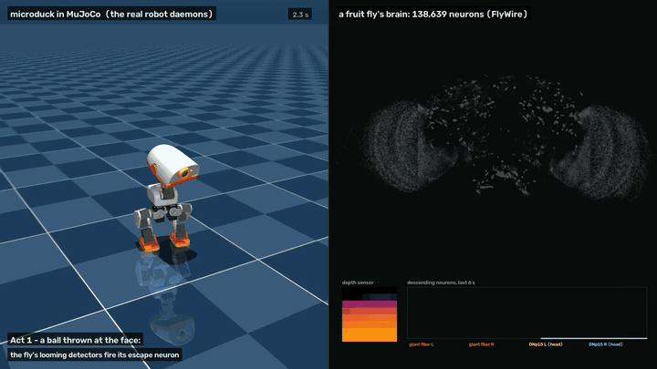

# Duckophila

**A fruit fly's brain, driving a [microduck](https://pollen-robotics.com/microduck/)** — the open-source robot duck from Pollen Robotics / Hugging Face.

<p align="center">
  <a href="media/duckophila.mp4"></a>
  <br><sub><b><a href="media/duckophila.mp4">Watch the full minute (MP4)</a></b> · <b><a href="https://huggingface.co/spaces/HW01/duckophila">on Hugging Face</a></b> — a ball thrown at the duck fires the fly's escape neuron (red rings); in a turning striped drum, the fly's motion detectors light up in both optic lobes (blue) and its head neuron steers the duck. Everything on the right is the recorded spikes of the real connectome; nothing is animated by hand.</sub>
</p>

Duckophila runs the complete wiring diagram of an adult *Drosophila* brain — FlyWire's
connectome, 138,639 neurons joined by 54 million synapses, as the leaky integrate-and-fire model of
Shiu et al. (2024) — in a closed loop with a [microduck](https://pollen-robotics.com/microduck/)
([`pollen-robotics/microduck`](https://github.com/pollen-robotics/microduck)):
the duck's depth sensor and camera become the fly's looming and motion detectors, and the fly's
descending neurons, read out, move the duck.

What the duck does, in the MuJoCo twin today:

- **It startles.** A ball thrown at its face fires the fly's giant fibre — the escape neuron —
  through the fly's own looming detectors (LPLC2, LC4), and the duck honks, ducks and backs off:
  19 of 20 throws at 1.5 m/s in the robot's twin. A hand approaching at petting speed never does
  (0 of 20) — though that speed threshold is ours, not the fly's (below).
- **It follows the world turning.** In a striped drum — the classic fly-arena experiment — its
  head turns with the stripes through DNp15/DNHS1, the descending neuron that turns a fly's head,
  at a closed-loop gain of 0.28 [0.24, 0.32]; the walking body follows the head. That is the
  optomotor reflex a fly holds its course with.

Neither is wired in, and both need the real wiring: with the connectome rewired — the same
neurons, the same weights, every neuron's number of inputs and outputs kept — the duck never
startles (0 of 20) and its head does not turn (gain 0.00). How specific each part is was measured
against controls, not assumed — and some of it is less specific than it looks (see
[Controls](#controls-and-statistics)).

## What is the fly's, and what is ours

The claim is only as good as this line, so it is drawn everywhere — in the code, the docstrings and
the docs.

| The fly's (unchanged) | Ours (hand-written, and labelled so) |
|---|---|
| Every neuron, every connection, every sign | ToF frames → looming detector input (`looming.py`) |
| Which neurons answer looming, which answer rotation | Camera → optic flow → motion detector input (`motion.py`) |
| The giant fiber's decision to fire | The shape of the flinch (honk, look, crouch, back off) |
| Which way DNp15 and DNa02 say to turn | The gains, the smoothing, and that the body follows the head |
| Where each motion detector looks (FlyWire's column map) | The approach-speed gate that spares a petting hand — so the startle's speed tuning is ours |

The brain is not tuned, retrained or edited. Its input is shaped like a fly's sensory neurons
would be, and its output is read from the neurons the literature says carry it.

## See it

```sh
./demo.sh          # both acts, live in the Rerun viewer, and recorded to demo/*.rrd
```

Act 1 throws three balls and one slow hand; act 2 is the walking duck in the turning drum. The
viewer shows every neuron at its real place in the brain, lit when it spikes, beside the depth
frame, the camera with its optic flow, and the descending neurons that move the duck. A recording
replays with `.venv/bin/rerun demo/arena.rrd`.

`./demo.sh --video` also records the duck's pose and every brain step, and renders the video above
(`video/make_video.py`, `uv sync --group video` for MuJoCo): the simulator re-rendered from the
recorded pose, the brain from the recorded spikes.

## Set it up

You need a Mac or Linux box, [uv](https://docs.astral.sh/uv/), the
[microduck](https://github.com/pollen-robotics/microduck) daemon repo (its `scripts/duck-sim` runs
the real robot daemons against MuJoCo) and the `microduck_rl` simulator it uses. The layout
expected, all side by side:

```
microduck/          the daemon repo, with scripts/duck-sim
microduck_rl/       the MuJoCo simulator (unmodified)
duckophila/         this
```

> **Until [pollen-robotics/microduck#513](https://github.com/pollen-robotics/microduck/pull/513) is merged,
> check out its branch in `microduck/`.** Without it the simulated duck stands but never walks
> (`duck-sim` loads an obsolete gait on a robot model the current one was not trained on), and the
> body-steering experiments have nothing to steer:
>
> ```sh
> git -C microduck fetch https://github.com/first-it-consulting/microduck.git duck-sim-walks
> git -C microduck switch -c duck-sim-walks FETCH_HEAD
> ```

```sh
cd duckophila
uv sync
git clone --depth 1 https://github.com/philshiu/Drosophila_brain_model.git   # the connectome, as the model reads it
mkdir -p data results
curl -L -o data/flywire_783_annotations.tsv \
  https://raw.githubusercontent.com/flyconnectome/flywire_annotations/main/supplemental_files/Supplemental_file1_neuron_annotations.tsv
# signed in at codex.flywire.ai -> FAFB v783 -> Download Data -> "Visual Neuron Columns"
#   -> data/column_assignment.csv.gz
```

FlyWire's files are not redistributed here: Codex needs a sign-in and its terms. Then check the
brain before trusting anything built on it:

```sh
.venv/bin/python -I experiments/sugar_mn9.py 30   # the paper's own check, in its own simulator (Brian2)
.venv/bin/python -I experiments/replay.py         # expect: identical == brian2 spikes
uv run --with pytest pytest -q tests              # what CI runs on Linux, plus what needs the columns
```

## Run it by hand

```sh
DUCK_SIM_CAMERAS=a sim/duck-sim             # the duck, its camera, a ball and a drum in the room
.venv/bin/python -I bridge.py               # startle only
.venv/bin/python -I throw.py                # a ball at 1.5 m/s at the face
.venv/bin/python -I throw.py --side left --speed 1
.venv/bin/python -I throw.py --speed 0.2    # petting speed: ignored
.venv/bin/python -I bridge.py --steer head  # and the head's optomotor reflex
.venv/bin/python -I bridge.py --steer body  # or the whole duck, walking, the body following the head
.venv/bin/python -I drum.py --speed 30 --period 8
sim/duck-sim down
```

`bridge.py --dry` sends the duck nothing, `--no-viz` skips the viewer, `--record FILE.rrd` saves
the view. `MICRODUCK=` and `DUCK_SIM_RL=` point `sim/duck-sim` elsewhere.

## What is where

- `flysim.py` — the brain. Shiu et al.'s model, reimplemented to be stepped: state held between
  calls, and neurons that provably cannot fire before their next input not stepped at all. Given
  the same input it produces Brian2's spikes exactly, step for step (`experiments/replay.py`); it
  runs ~25x faster than real time at rest and ~2.5x under heavy visual drive, on one Apple M5 core.
- `neurons.py` — cell types → FlyWire 783 neuron ids, and the roles the duck uses.
- `retinotopy.py` — FlyWire's visual columns → where each motion detector looks. Which way is
  front and which is up are read off the fly's own wiring (each LPLC2's four arms take outward
  motion; HSN takes input above HSS), not assumed.
- `looming.py` — **ours**: the depth sensor as the fly's looming detectors.
- `motion.py` — **ours**: the camera as the fly's motion detectors, with efference copies of the
  duck's own head turns and walking.
- `geometry.py` — which depth zones see the floor, and the duck's own motion, from `robot.state`.
- `bridge.py` — the loop: the robot's own sockets in, the brain, intents out; the Rerun view.
- `throw.py`, `drum.py` — the ball and the striped drum.
- `video/` — `record_sim.py` (the duck's pose, 30 Hz) and `make_video.py` (sim and brain, side by side).
- `sim/` — puts the ball and the drum into the simulator without changing it: a generated copy of
  a `microduck_rl` scene, and a `sitecustomize.py` that moves them (inert unless `DUCKOPHILA_PROP=1`).
- `experiments/` — every claim above, as a script:
  `sugar_mn9.py`, `replay.py`, `compare.py`, `realtime.py`, `bench.py` (the brain); `looming_gf.py`,
  `tof_scenes.py` (the startle); `optomotor_dn.py`, `optomotor_replay.py`, `columns_orient.py`,
  `retinotopy_check.py` (the motion pathway); `ego_nod.py`, `ego_lag.py`, `ego_flow_check.py`
  (the efference copy).

## Controls and statistics

Every claim above, repeated, against brains that are wired wrong (`experiments/controls.py`,
open loop, 20 seeds; `experiments/closed_loop_stats.py`, the whole robot stack, 20 throws).
95% confidence intervals.

| | intact | rewired¹ | signs flipped | input null² |
|---|---|---|---|---|
| startle, ball 0.6–1.5 m/s (open loop) | **1.00** [0.91, 1.00] | 0.00 | 0.00 | 0.50 [0.35, 0.65] |
| startle, ball 0.2 m/s (open loop) | 0.00 [0.00, 0.09] | 0.00 | 0.00 | 0.00 |
| startle, ball 1.5 m/s (closed loop) | **0.95** [0.76, 0.99] | 0.00 [0.00, 0.16] | | |
| startle, hand 0.2 m/s (closed loop) | 0.00 [0.00, 0.16] | 0.00 | | |
| giant fibre on the ball's side (share of its spikes) | 0.58 [0.56, 0.59] open · 0.57 [0.45, 0.66] closed | — | — | 0.54 [0.52, 0.56] |
| false startle walking at a wall, 0.3 m/s | 6/20 | 0/20 | 0/20 | 2/20 |
| head optomotor gain (closed loop) | **0.28** [0.24, 0.32] | 0.00 | | |
| DNp15 follows rotation (camera view) | **yes**: rank 1 of 383 DN pairs³ | no | no | |
| DNa02 follows rotation | whole eye yes · camera view no | no | no | |

¹ each connection keeps its source neuron and weight, gets a random target; every neuron keeps its
number of inputs and outputs. ² the intact brain, with the looming input sent to as many *other*
visual projection neurons. ³ of all descending neuron types with one neuron a side, 13 follow
rotation; DNp15 follows most strongly.

What this says, and does not:

- **The behaviours need the connectome.** Rewired or sign-flipped, the brain stays active but
  nothing reaches the descending neurons: no startle, no turning.
- **The optomotor readout is specific.** DNp15 is the strongest follower of 383 candidates.
- **The startle is only partly specific.** Driving LPLC2/LC4 startles every time; driving the same
  number of random visual neurons still startles half the time. The giant fibre listens to more
  than the looming detectors, at least in this model.
- **The side is weak.** The giant fibre on the ball's side fires only slightly more (58%), and nearly
  as much with random input (54%). An earlier version of this README said a ball from the left
  fires the left giant fibre; that overstated it.
- **The speed tuning is ours.** No startle at 0.2 m/s comes from our approach-speed gate, not the
  fly (the input null shows the same cut). At 2 m/s the encoder misses 30% of throws.
- **There are false alarms.** Walking towards a wall at 0.3 m/s startles 6 times in 20.

## What does not work yet

- **The camera sees far less than a fly.** About 45° x 73° straight ahead, against ~140° per fly
  eye, so only ~1,400 of the fly's 12,000 motion detectors get input. That is enough for the head
  reflex, not for DNa02 — the literature's body-steering neuron flips with rotation over the whole
  eye but not over that view (`--steer dna02` shows it) — and not for looming through the camera.
  The depth sensor is the looming sense.
- **The simulator's gait**: it walks at ~40% of the speed asked, ignores small turns on the spot
  and sometimes will not take a first slow step; the body steers while walking at 0.1 m/s.
- **No real duck yet.** On hardware, the camera/state timing has to be measured again
  (`experiments/ego_lag.py`), and the brain belongs on a laptop reaching the duck over WebRTC.
- Next on the list: the fly's courtship-pursuit circuit (LC10 → P1) as "follow me", and
  mushroom-body learning with petting as the reward.

## Things that were not obvious

- In the reference model, `v` and `g` are `(unless refractory)`, which Brian2 turns into
  conditional writes: **input arriving during refractory is dropped**, not banked. Missing that
  made every downstream neuron fire ~20% fast while looking plausible.
- **A standing duck sways its head**, and ~45 of 64 depth zones see the floor, which then
  approaches and recedes. Without a floor filter, 30% of quiet frames drove the looming detectors.
  The kinematic pose is also 2–3° off near the horizon, where it decides everything: the filter
  needs an angular margin, or grazing floor returns startle the duck every few seconds.
- **Random retinotopy breaks LPLC2.** Each of its arms wants outward motion from its own part of
  the field. Motion detectors drawn onto the image at random hand it scrambled motion, and the
  drum fired the giant fiber 7–11 times a run; with FlyWire's columns, never.
- **A walking duck's view is mostly its own doing, and mostly rotation** — the gait bobs the camera
  by 30–80°/s, walking forward adds ~10°/s. The efference copy predicts both from `robot.state` and
  subtracts them (yaw left in: yaw slip is what the reflex steers by). It only worked once each frame
  was paired with the state from its own capture time (the newest state is a third of a stride out
  of phase), and once it subtracted only where the image has edges — on a blank wall the flow
  estimator sees no motion, and subtracting there invents motion the other way.
- **Under visual drive ~50k neurons sit just off rest.** Stepping them all was 4x slower than real
  time, and parallelising per step was worse. A closed-form bound on how high a neuron's voltage
  can still climb lets the ones that cannot fire sleep until their next input — exactly.
- `mediad` serves one camera frame per connection, and sometimes hands out the same render twice.

## Paper

[`paper/duckophila.pdf`](paper/duckophila.pdf) — the full account: methods, every number above and
where it came from, the failure modes, and the limits. Its figures are built from data by
`paper/figures.py`; the PDF by `tectonic -X compile paper/duckophila.tex`.

## Credit

The fly is not ours. Please cite:

- Dorkenwald et al., *Neuronal wiring diagram of an adult brain*, Nature (2024) — FlyWire
- Schlegel et al., *Whole-brain annotation and multi-connectome cell typing of Drosophila*, Nature (2024)
- Matsliah et al., *Neuronal parts list and wiring diagram for a visual system*, Nature (2024) —
  the visual columns
- Berg et al. (2026) and Tastekin et al. (2026) — cited by the current FlyWire annotations
  (`flyconnectome/flywire_annotations`, version ≥ 3.2)
- Shiu et al., *A Drosophila computational brain model reveals sensorimotor processing*, Nature
  (2024) — the model `flysim.py` reimplements ([code](https://github.com/philshiu/Drosophila_brain_model), MIT)

and follow FlyWire's [citation guidelines](https://codex.flywire.ai). The duck is
[Pollen Robotics'](https://pollen-robotics.com/microduck/) microduck.

## License

Apache-2.0, like microduck. The FlyWire data and the reference model keep their own terms and are
fetched, not included.
